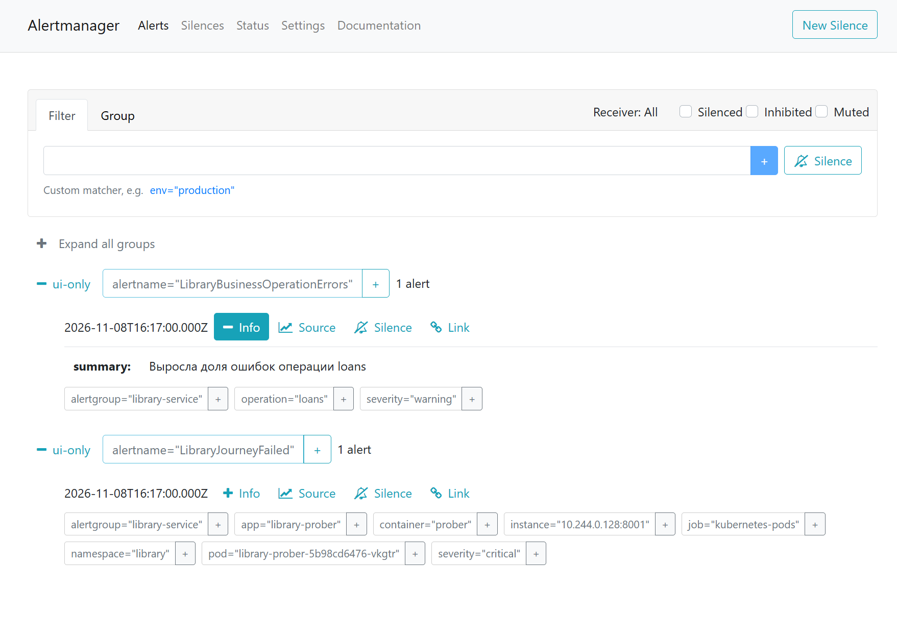
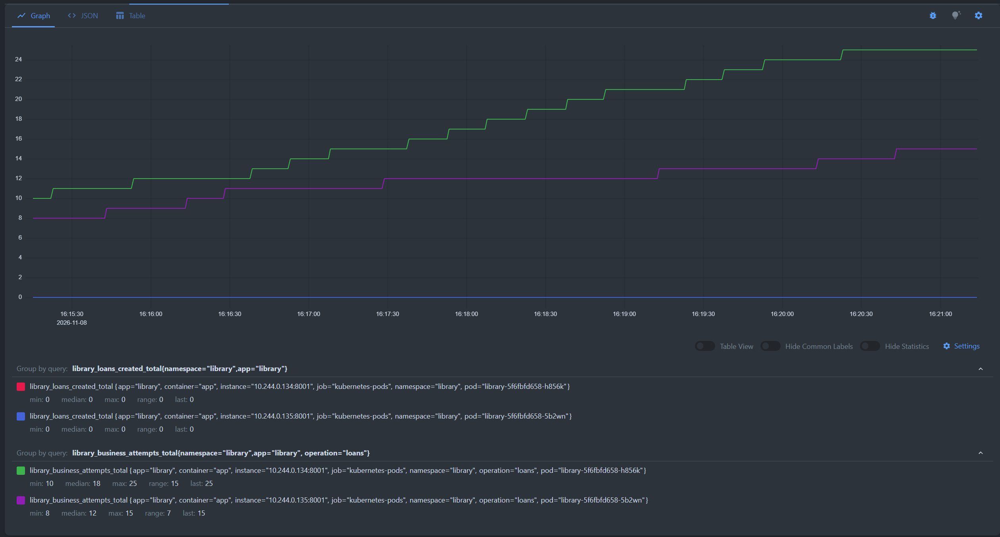
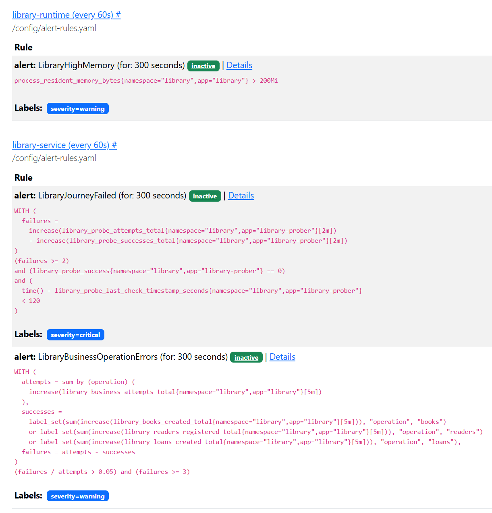

# Отчёт 6. Проектирование алертов для «Библиотеки»

## 1. Какие алерты нужны сервису

### Алерты сервиса

| Алерт | Источник и условие | Что означает |
|---|---|---|
| **Сбой сквозного сценария** (`LibraryJourneyFailed`, `critical`) | Последняя проверка завершилась ошибкой менее 2 минут назад. За последние 2 минуты было как минимум две неудачные проверки. Неудачи считаются по разности приростов `library_probe_attempts_total` и `library_probe_successes_total`. | Пробер обращается к API через Kubernetes Service и проверяет создание и чтение записей. Две неудачи отсекают одиночный сбой, а проверка времени привязывает алерт к свежему результату. |
| **Рост ошибок бизнес-операции** (`LibraryBusinessOperationErrors`, `warning`) | За 5 минут у одной операции больше 5% неуспешных попыток и как минимум 3 неудачи. Для каждой операции сравниваются прирост `library_business_attempts_total` и прирост соответствующего счётчика успехов (`library_books_created_total`, `library_readers_registered_total` или `library_loans_created_total`). | Порог по доле помогает заметить деградацию при разном объёме трафика, а разбивка по операциям указывает, какая функция затронута. Минимум три неудачи защищают от срабатывания из-за единичной ошибки при низкой нагрузке. |

У обоих реализованных алертов сервиса задано `for: 5m`. Пятиминутная выдержка нужна, чтобы оповещать об устойчивых сбоях.

В бизнес-SLI учитываются завершённые попытки, дошедшие до бизнес-логики. Ожидаемые отказы `404`, `409` и `422` исключены из этих счётчиков попыток. Запросы пробера входят в бизнес- и HTTP-метрики приложения.

### Алерт рантайма Python

**Высокое потребление памяти процессом приложения** (`LibraryHighMemory`, `warning`). `process_resident_memory_bytes` одной реплики приложения выше 200 МиБ непрерывно 5 минут. Порог составляет около 78% от [лимита контейнера в 256 МиБ](../k8s/05-app.yaml). Запас до лимита даёт время заметить рост потребления памяти, а проверка по каждой реплике выявляет проблему в отдельном Pod.

## 2. Проверка срабатывания

Для проверки включён учебный отказ выдачи книг через `SLO_DEMO_FAIL=loans`. После повторных ошибок пробера и выдержки в Alertmanager появились `LibraryJourneyFailed` и `LibraryBusinessOperationErrors`. У бизнес-алерта видна метка `operation="loans"`. Оба алерта направлены получателю `ui-only`.

На графике VictoriaMetrics растёт число попыток выдачи на обеих репликах, а счётчик успешных выдач остаётся на нуле.

Конфигурация стенда хранится в [правилах vmalert](../k8s/metrics/library-alerts.yaml) и [настройках Helm для Alertmanager](../k8s/metrics/alertmanager-values.yaml).

### 3. Алерты в vmalert-ui

