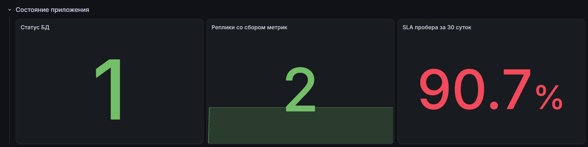
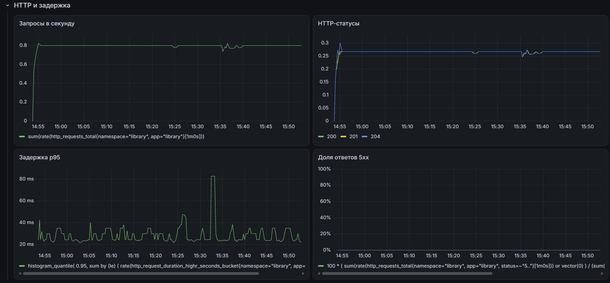
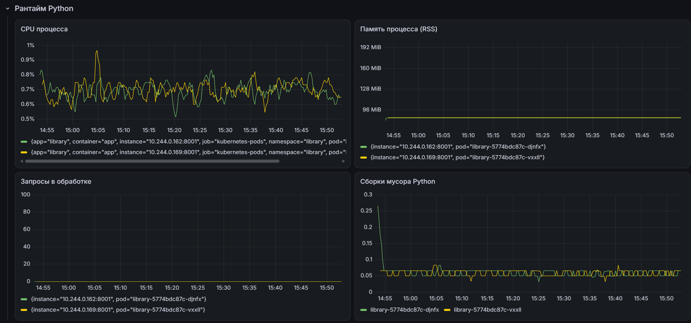

# Отчёт 7. Дашборд Grafana для приложения «Библиотека»

Grafana развёрнута через Helm в minikube. Три ряда дашборда показывают состояние приложения, HTTP и задержку, а также метрики рантайма Python. [Экспорт Library Dashboard](../artifacts/grafana.json)

## Источники данных

В Grafana используется источник **VictoriaMetrics** типа **Prometheus**. VictoriaMetrics Single каждые 15 секунд собирает метрики приложения FastAPI, его процесса Python, сквозного пробера и PostgreSQL Exporter. Grafana запрашивает эти данные через Prometheus API по адресу `http://vmsingle-victoria-metrics-single-server.metrics.svc.cluster.local:8428`.

## Состояние приложения

| Панель | Метрика и назначение |
| --- | --- |
| Реплики со сбором метрик | Сумма `up` по репликам приложения. Показывает, со скольких реплик VictoriaMetrics успешно получает метрики. |
| Статус БД | `pg_up` показывает, доступен ли PostgreSQL для экспортера. |
| SLA пробера за 30 суток | Прирост `library_probe_successes_total`, делённый на прирост `library_probe_attempts_total` и умноженный на 100. Показывает долю успешных сквозных сценариев. Цель SLA составляет не менее **99,5%**. |

## HTTP и задержка

| Панель | Метрика и назначение |
| --- | --- |
| Запросы в секунду | `rate(http_requests_total)` с суммированием по репликам показывает интенсивность трафика. |
| HTTP-статусы | Тот же счётчик с разбивкой по `status` помогает увидеть, какие коды ответа появляются и с какой частотой. |
| Доля ответов 5xx | Отношение RPS ответов `5xx` к общему RPS показывает долю серверных ошибок при разной нагрузке. |
| Задержка p95 | `histogram_quantile()` по корзинам `http_request_duration_highr_seconds_bucket` показывает время, в которое укладываются примерно 95% запросов. |

## Рантайм Python

| Панель | Метрика и назначение |
| --- | --- |
| CPU процесса | `rate(process_cpu_seconds_total)` показывает использование CPU по репликам. На панели 100% соответствует одному ядру. |
| Память процесса (RSS) | `process_resident_memory_bytes` помогает заметить рост объёма физической памяти процесса в отдельной реплике. |
| Запросы в обработке | `http_requests_inprogress` показывает число одновременно обрабатываемых запросов. Рост вместе с p95 может указывать на насыщение приложения. |
| Сборки мусора Python | `rate(python_gc_collections_total)` показывает частоту сборок мусора по репликам. Её можно сопоставить со всплесками CPU и задержки. |

Для панелей HTTP использован подход **RED** с метриками трафика, ошибок и задержки. Панели рантайма используют подход **USE** для оценки загрузки CPU и памяти и поиска признаков насыщения. Насыщение дополняет три метрики RED до четырёх **Golden Signals**.

## Дашборд PostgreSQL Exporter

Для дашборда PostgreSQL Exporter используется тот же источник **VictoriaMetrics**.

