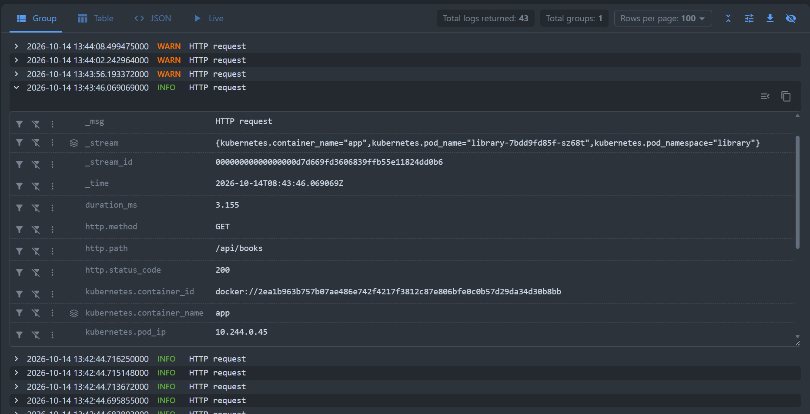
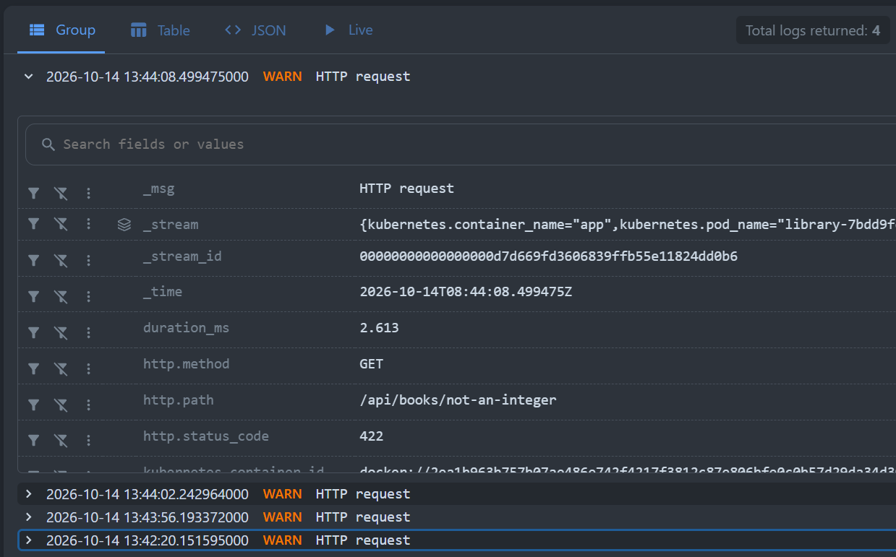
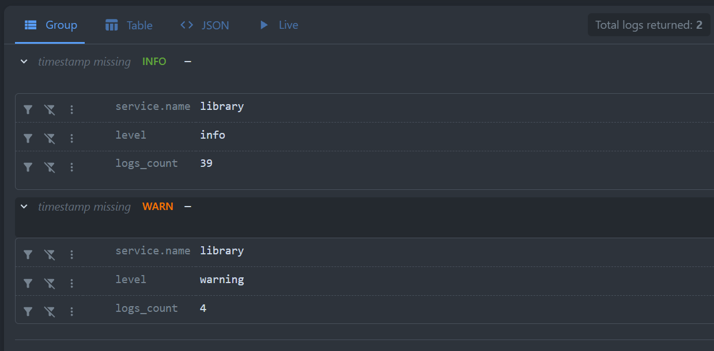
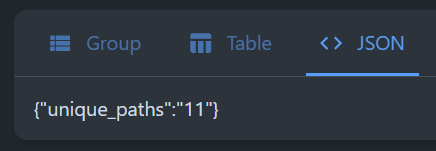

# Отчёт 3. Анализ логов приложения в VictoriaLogs

Логи приложения «Библиотека» собираются в VictoriaLogs. Ниже подготовлены четыре LogsQL-запроса для выполнения через vmui.

## 1. Сырые записи за последние 15 минут

```text
_time:15m AND service.name:="library"
```

**Что показывает:** отдельные записи приложения за последние 15 минут без агрегации.



## 2. Фильтр по полю level

```text
_time:15m AND service.name:="library" AND level:="warning"
```

**Что показывает:** только записи с точным значением `warning` в поле `level`. В нашем приложении этот уровень получают HTTP-ответы 4xx, например 404 для неизвестного пути и 422 при ошибке валидации. Так можно отдельно изучать неуспешные клиентские запросы.



## 3. Количество записей с группировкой по сервису и уровню

```text
_time:15m AND service.name:="library"
| stats by (service.name, level) count() as logs_count
```

**Что показывает:** число записей `logs_count` для каждой пары «сервис — уровень». Например, отдельные строки для `library / info` и `library / warning`.



## 4. Количество уникальных HTTP-путей

```text
_time:15m AND service.name:="library"
| stats count_uniq(http.path) as unique_paths
```

**Что показывает:** количество различных непустых значений поля `http.path` в логах за последние 15 минут. Это позволяет оценить, к скольким разным путям обращались пользователи.



## Почему выбран такой способ доставки логов

Используется цепочка: **structlog → JSON в stdout контейнера → vlagent → VictoriaLogs**. Официальный Helm-chart `victoria-logs-collector` разворачивает vlagent как DaemonSet — по одному сборщику на подходящем узле Kubernetes.

Для нашего учебного приложения этот способ удобен по следующим причинам:

- Приложение просто пишет JSON в stdout. Адрес хранилища и отправка логов настраиваются отдельно, в collector.
- Один сборщик на узле обслуживает все реплики приложения; добавлять sidecar в каждый Pod не требуется.
- Collector добавляет Kubernetes-метаданные, поэтому в VictoriaLogs можно найти источник записи по namespace, Pod и контейнеру.
- Настроены дисковая очередь и повторные отправки при временной недоступности хранилища. Это помогает пережить короткий сбой в пределах доступного буфера.
- Официальные Helm charts позволяют повторить установку и менять настройки через два небольших values-файла.
