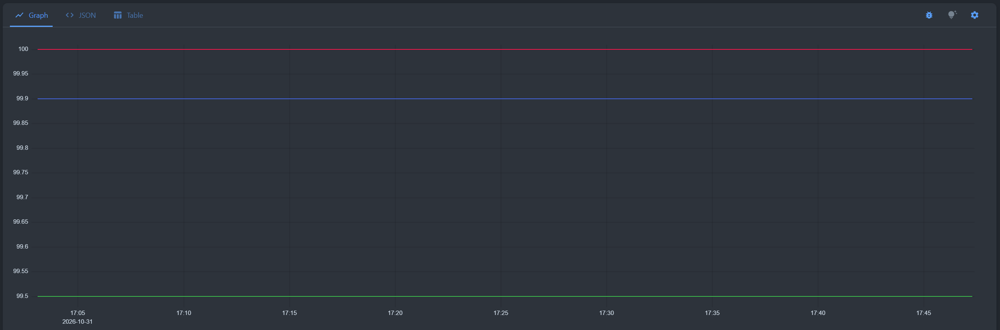
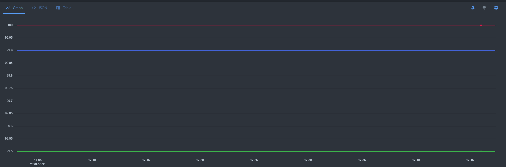
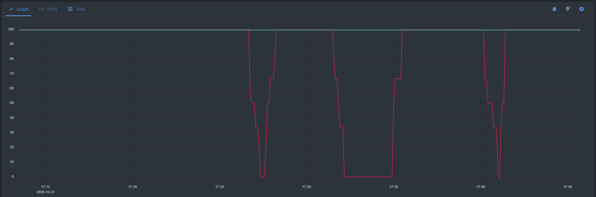

# Отчёт 5. Доступность услуг библиотеки

Доступность приложения оценивается по тому, может ли пользователь выполнить нужную операцию: добавить книгу, зарегистрировать читателя и оформить выдачу. Для этого используются бизнес-метрики из задания №4.

## 1. Метрики и SLI

| Бизнес-метрика из задания №4 | Что означает |
|---|---|
| `library_books_created_total` | Успешно добавленные экземпляры книг |
| `library_readers_registered_total` | Успешно зарегистрированные читатели |
| `library_loans_created_total` | Успешно оформленные выдачи книг |

Эти счётчики увеличиваются после сохранения данных. Одного количества успехов недостаточно для оценки доступности: нужно знать число попыток. Поэтому добавлен `library_business_attempts_total{operation="books|readers|loans"}`. Он учитывает завершённые попытки соответствующей операции, включая серверные ошибки.

SLI — фактическая доля успешных операций. Используется подход RBSLO:

```text
SLI_books = 100 × успешно добавленные книги / попытки добавления книги
SLI_readers = 100 × успешные регистрации / попытки регистрации
SLI_loans = 100 × успешные выдачи / попытки выдачи
```

Для расчёта берётся прирост счётчиков за период, сначала через `increase` для каждой реплики, затем суммируется. Некорректные данные (422), отсутствующие связанные записи (404) и бизнес-конфликты (409), например уже выданная книга, исключаются из попыток: это ожидаемые отказы, а не недоступность услуги. Ошибки сервера учитываются как неуспешные попытки. При отсутствии попыток SLI не определён, а не равен 100%.

Счётчики приложения видят только вызовы, дошедшие до бизнес-логики. Поэтому полный отказ приложения дополнительно проверяется независимым пробером.

### SLI создания книг



### SLI регистации читателей



### SLI оформления выдачи



## 2. SLO

SLO — целевое значение SLI за последние 30 суток.

| Услуга | SLO |
|---|---|
| Добавление книги | Не менее 99,9% успешных попыток |
| Регистрация читателя | Не менее 99,9% успешных попыток |
| Выдача книги | Не менее 99,9% успешных попыток |
| Полный пользовательский сценарий пробера | Не менее 99,9% успешных проверок |

Каждый SLO выполнен, если соответствующий `SLI ≥ 99,9%`. Бюджет ошибок — 0,1% попыток: например, 10 ошибок на 10 000 операций.

## 3. Пробер и SLA

Пробер работает в отдельном Pod. Каждые 15 секунд он начинает проверку: создаёт тестового автора и книгу, регистрирует тестового читателя, оформляет выдачу. После каждого создания он читает запись через API и сверяет данные. Если цикл длится больше 15 секунд, следующий начинается после его завершения.

Успех — весь сценарий завершён с ожидаемыми ответами и правильными сохранёнными данными. Таймаут каждого HTTP-запроса — 3 секунды. Ошибка на любом шаге делает весь сценарий неуспешным, включая отказ соединения. После проверки пробер удаляет только созданные им записи в обратном порядке. Проверки реально вызывают бизнес-операции и увеличивают выбранные счётчики.

Учебный SLA: **не менее 99,5% успешных полных сценариев за 30 суток**.

```text
SLI_scenario = 100 × успешные сценарии / все завершённые сценарии
SLA выполнен, если SLI_scenario ≥ 99,5%
Допустимое число неудач = 0,005 × число сценариев
```

## 4. Изменения и скринкаст

Добавлен учёт попыток в сервисы книг, читателей и выдач. В `src/slo_demo.py` предусмотрен учебный отказ выбранной операции через `SLO_DEMO_FAIL=books`, `readers`, `loans` или `all`. Без этой переменной приложение работает обычно. Отказ учитывается в попытках, но счётчик успешных операций не увеличивается.

Пробер реализован в `src/prober.py`, манифест — `k8s/metrics/prober.yaml`.

Скринкаст с демостраницей изменения SLI для метрики регистрации выдач находится в `artifacts/screencast-hw5.mp4`

